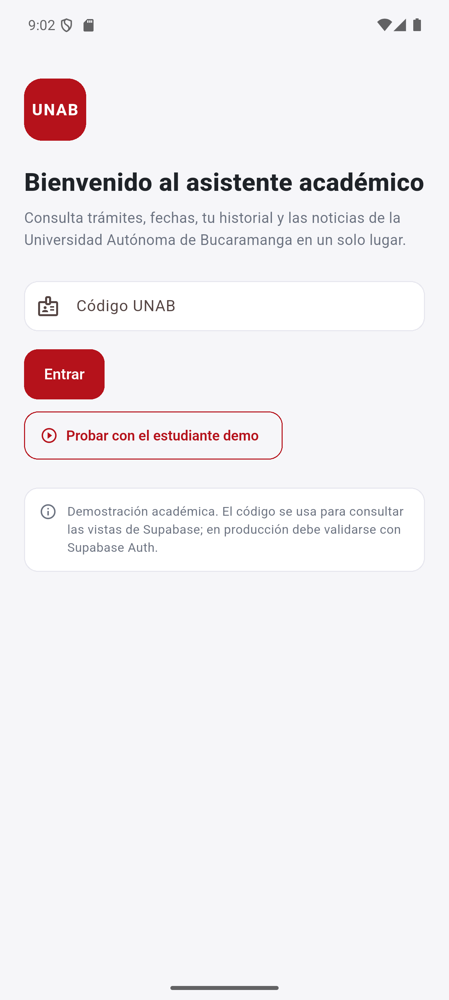
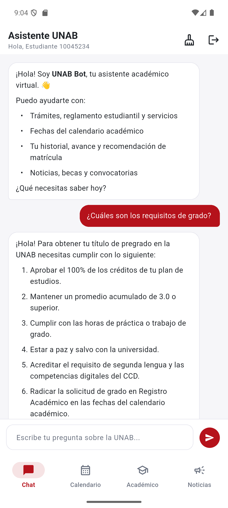
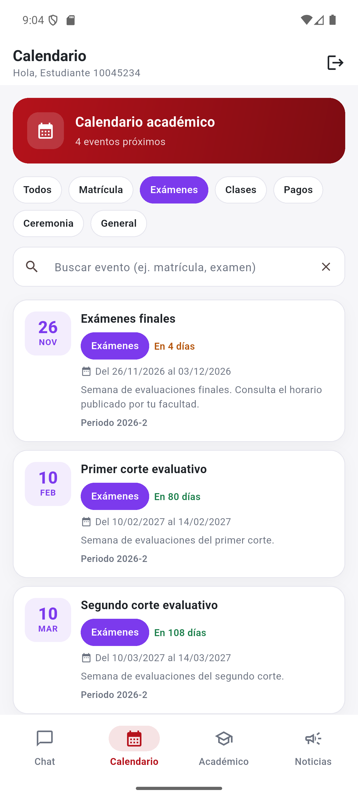
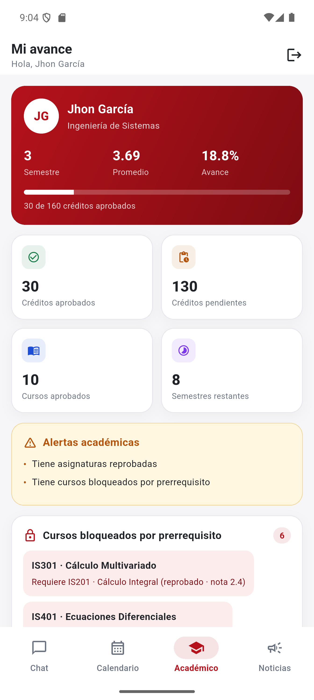
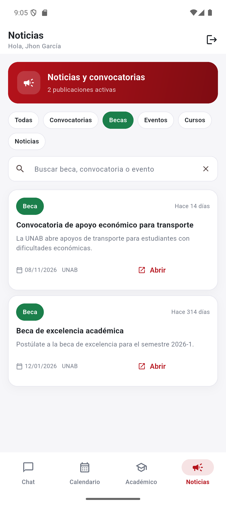

# Manual de usuario · Asistente UNAB

Guía para un estudiante que usa la app Android. No requiere conocimientos
técnicos. Las capturas correspondientes están en [`capturas/`](capturas/).

---

## 1. Acceder

1. Abre la app **Asistente UNAB**.
2. En la pantalla de bienvenida pulsa **Probar con el estudiante demo**
   (o escribe el código `10045234` y pulsa **Entrar**).

> El código `10045234` corresponde a **Jhon García**, un estudiante sintético
> de Ingeniería de Sistemas. No hay datos reales ni contraseñas.

---

## 2. Hacer una pregunta en el chat

1. En la barra inferior pulsa **Chat**.
2. Escribe tu pregunta en el campo *«Escribe tu pregunta sobre la UNAB...»* y
   pulsa **Enviar**. También puedes tocar una de las sugerencias.
3. El asistente escribe la respuesta y muestra debajo la **fuente** consultada
   (por ejemplo `proceso_grado.md`).

Preguntas que funcionan bien:

- «¿Cuáles son los requisitos de grado?»
- «¿Cuántos créditos puedo matricular?»
- «¿Qué es el Centro de Competencias Digitales?»
- «¿Qué prerrequisitos bloquean Cálculo Multivariado?»

**Consejo:** si la respuesta tarda, espera sin salir de la pantalla. La primera
llamada puede tomar unos segundos porque despierta el workflow en n8n Cloud.

---

## 3. Consultar el calendario

1. Pulsa **Calendario** en la barra inferior.
2. Usa el buscador *«Buscar evento (ej. matrícula, examen)»* o los chips de
   categoría (Exámenes, Matrícula, General, Ceremonia).
3. Cada tarjeta muestra el evento, las fechas y **cuántos días faltan**.

> Puedes escribir `examen` sin tilde: la búsqueda ignora acentos y mayúsculas.

---

## 4. Revisar tu avance académico

1. Pulsa **Académico**.
2. Verás tu semestre, promedio, porcentaje de avance y una proyección de
   semestres restantes.
3. Más abajo están las **alertas** y los **cursos bloqueados** con su motivo.

Para el estudiante demo ocurre lo siguiente: reprobó **Cálculo Integral
(IS201)** con nota 2.4, por lo que **Cálculo Multivariado (IS301)** aparece como
bloqueado. La recomendación es repetir IS201 antes de matricular IS301.

También puedes preguntar en el chat: *«¿Qué cursos puedo matricular el próximo
semestre?»*. El agente cruzará tu historial con la tabla de prerrequisitos.

---

## 5. Ver noticias y convocatorias

1. Pulsa **Noticias**.
2. Filtra por texto (*«Buscar beca, convocatoria o evento»*) y por categoría
   (Beca, Convocatoria, Evento, Curso, Noticia).
3. Pulsa **Abrir** en una tarjeta para ver la publicación completa en el
   navegador.

Las noticias se actualizan automáticamente cada 6 horas desde dos fuentes RSS
y solo se muestran las publicadas en los últimos 45 días.

---

## 6. Cerrar sesión y empezar de nuevo

Pulsa **Cerrar sesión** en la esquina superior derecha. Para limpiar una
conversación, pulsa **Nuevo chat** y luego **Empezar**. El historial de la demo
se guarda en el dispositivo; al cerrar sesión se borra la sesión local.

---

## 7. Solución de problemas

| Síntoma | Qué hacer |
|---------|-----------|
| «n8n respondió 500» | Vuelve a enviar la pregunta. Si persiste, revisa el estado del MCP (`docs/capturas/07-mcp.png`). |
| La lista de calendario sale vacía | Quita los filtros con **Quitar filtros**. |
| No aparece el avance académico | Comprueba que entraste con `10045234` y pulsa **Reintentar**. |
| No hay noticias nuevas | Espera a la próxima ejecución RSS o quita el filtro de categoría. |
| La app no conecta | Verifica que el teléfono tenga internet y que la URL de n8n esté activa. |

---

## 8. Límites de la demo

- El login es **demostrativo**: no valida contraseña institucional.
- Los datos son **sintéticos**; no representan a estudiantes reales.
- El botón de notificaciones push está desactivado: no se envían mensajes a
  dispositivos.
- Las respuestas pueden variar ligeramente entre ejecuciones porque el LLM es
  generativo, aunque la temperatura está fijada en 0.2.
